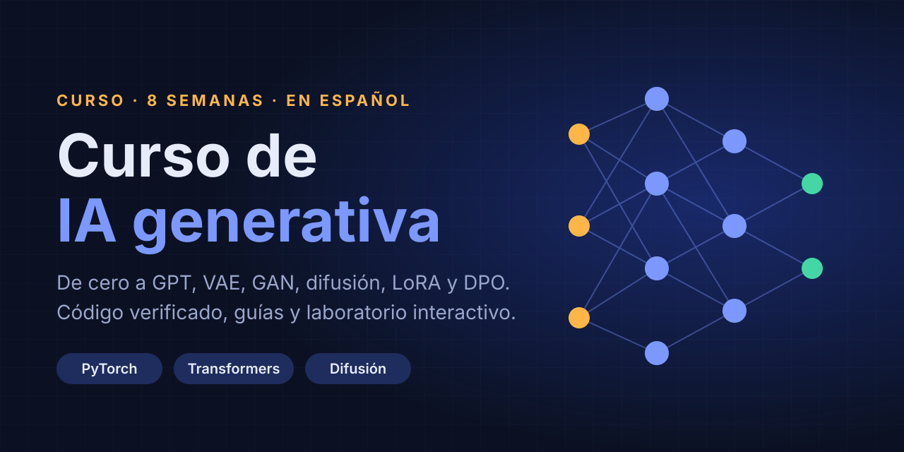
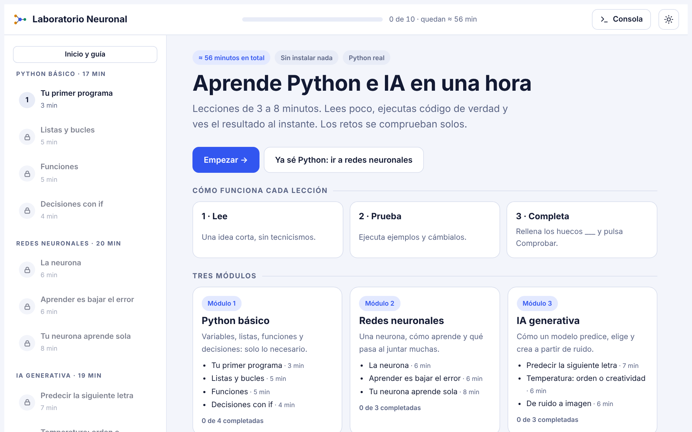
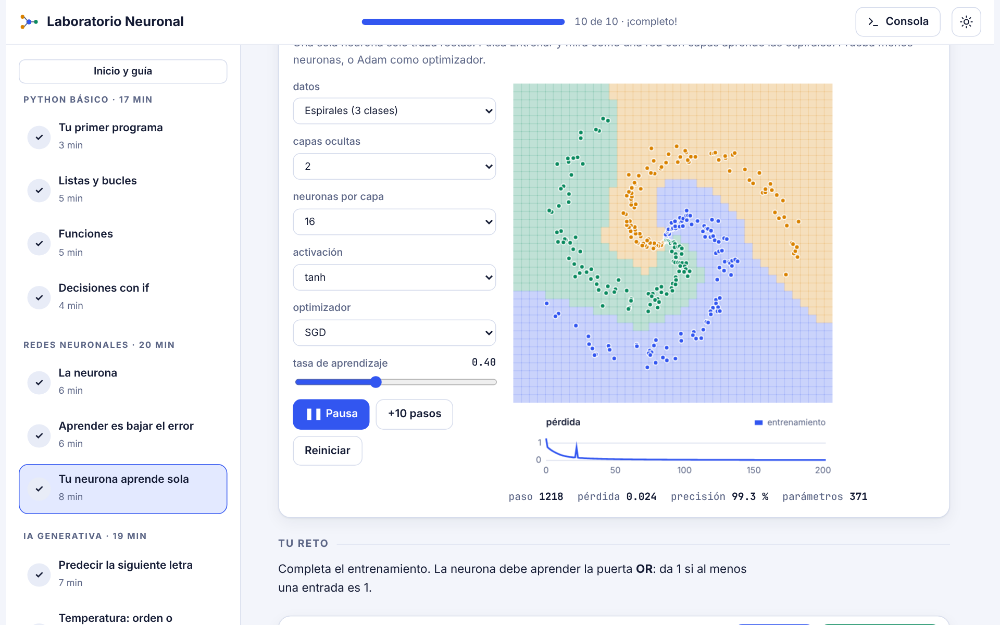
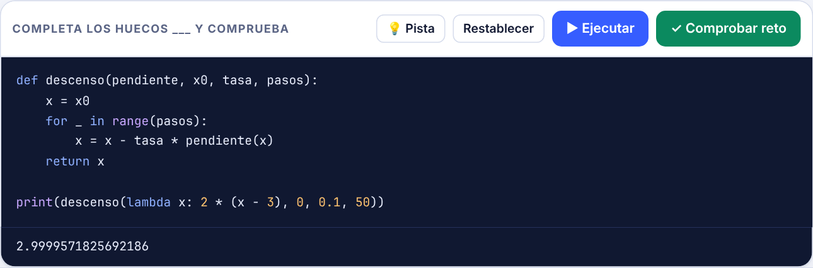
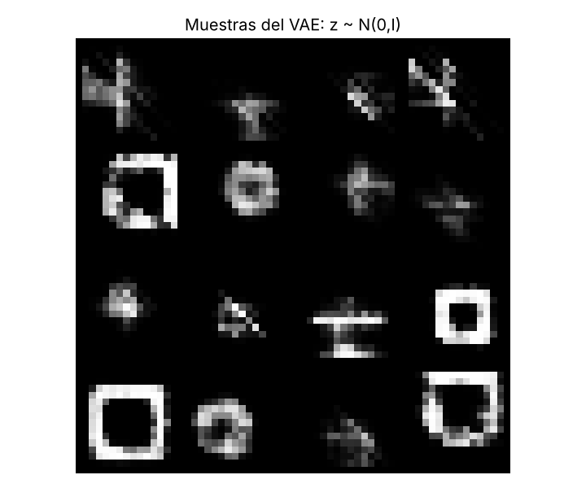
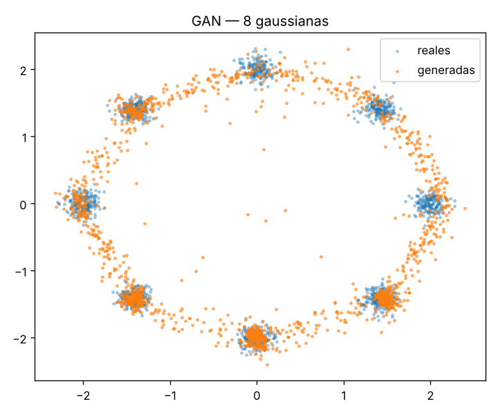
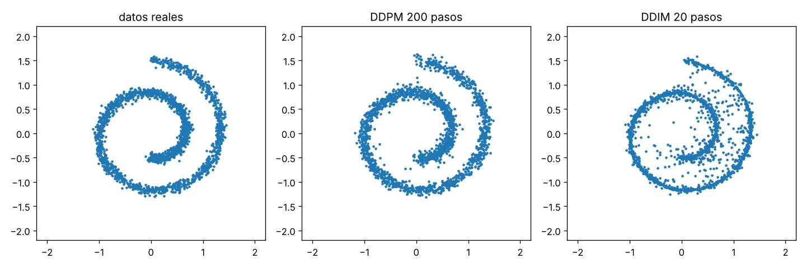
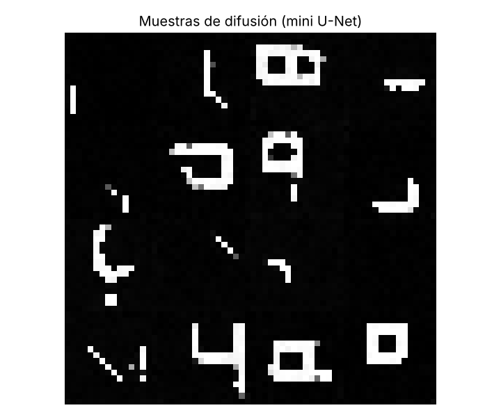

<p align="center">
  
</p>

<p align="center">
  <a href="https://fx010.github.io/curso-ia-generativa/"></a>
  <a href="guias/00-plan-maestro.md"></a>
</p>

<p align="center">
  <a href="https://github.com/FX010/curso-ia-generativa/actions/workflows/tests.yml"></a>
  
  
  
  
</p>

# Curso de IA generativa

**Construye tus propias redes neuronales, un GPT, un VAE, una GAN, un modelo de difusión, LoRA y DPO, y entiende por qué funcionan.** Un curso práctico en español, de 8 semanas y unas 100 horas, donde cada idea se implementa desde cero, se mide y se verifica. Todo corre en CPU, sin GPU y sin descargar datos.

- 📚 **8 guías semanales** con teoría, matemática, diagramas de dimensiones, ejercicios y autoevaluación con respuestas.
- 🧪 **28 archivos de código** (autograd, MLP, CNN, GPT con RoPE y GQA, VAE, GAN, difusión, LoRA, DPO, RAG) con **19 pruebas automáticas**.
- 🕹️ **[Laboratorio Neuronal](https://fx010.github.io/curso-ia-generativa/)**: Python e IA en una hora, directamente en el navegador, para quien empieza.
- 🎞️ **Presentación** de 15 diapositivas, biblioteca de fuentes, guía de mapeo de redes y un proyecto final con rúbrica.

## 🕹️ Empieza en 5 minutos: el laboratorio

Si sabes poco de Python y tienes poco tiempo, empieza aquí. **10 lecciones de 3 a 8 minutos**: lees una idea corta, ejecutas ejemplos, completas un reto con huecos y se comprueba solo. Sin instalar nada y **sin conexión** una vez cargada la página.

| Inicio | Una red aprendiendo en vivo | Retos con comprobación |
|:--:|:--:|:--:|
|  |  |  |

**[▶ Abrir el laboratorio](https://fx010.github.io/curso-ia-generativa/)** · o descarga [`docs/index.html`](docs/index.html) y ábrelo con doble clic. Ejecuta un Python simplificado (sin clases ni `try/except`) cuya salida se verificó contra CPython real. [Más detalles](laboratorio/README.md).

## 🗺️ El curso, semana a semana

| Sem. | Tema | Qué construyes | Guía · Código |
|:--:|---|---|---|
| **1** | Cimientos: tensores, cálculo, **autograd** | `micrograd` propio con *gradient check* | [guía](guias/semana-1.md) · [código](codigo/semana1_micrograd) |
| **2** | MLP vectorizado y optimizadores | MLP en NumPy con backprop manual → PyTorch | [guía](guias/semana-2.md) · [código](codigo/semana2_mlp) |
| **3** | Ingeniería de entrenamiento y **mapeo** de redes | Modelo de lenguaje que alcanza la cota de entropía | [guía](guias/semana-3.md) · [código](codigo/semana3_entrenamiento) |
| **4** | CNN, residuales, RNN/LSTM/GRU | CNN contra MLP, medido con rigor | [guía](guias/semana-4.md) · [código](codigo/semana4_arquitecturas) |
| **5** | **Transformer** | BPE, atención, RoPE y tu **GPT** | [guía](guias/semana-5.md) · [código](codigo/semana5_transformer) |
| **6** | VAE y GAN | Compromiso reconstrucción/KL y cobertura de modos | [guía](guias/semana-6.md) · [código](codigo/semana6_vae_gan) |
| **7** | **Difusión** y LLM a escala | DDPM/DDIM sobre datos 2D e imágenes | [guía](guias/semana-7.md) · [código](codigo/semana7_difusion) |
| **8** | **LoRA, DPO, RAG**, interpretabilidad | Adaptación y alineamiento, medidos | [guía](guias/semana-8.md) · [código](codigo/semana8_adaptacion) |
| ★ | [**Proyecto final**](proyecto/proyecto-final.md) | 4 rutas con rúbrica de 100 puntos | |

Empieza por el [**plan maestro**](guias/00-plan-maestro.md): método de estudio, calendario y plan B de 8 horas por semana.

## ✅ Resultados verificados

Las cifras de las guías salen de ejecuciones reales de los scripts (CPU, datos sintéticos, semilla fija).

| Semana | Verificación | Resultado |
|:--:|---|---|
| 1 | Autodiff contra derivada numérica | error relativo ≈ 1e-10; red de 105 parámetros al 98 % |
| 2 | Backprop manual contra autograd de PyTorch | diferencia ≈ 1e-8; 99,3 % en espirales |
| 3 | Modelo de lenguaje contra la cota de entropía | **0,205** frente a **0,202** nats/carácter |
| 4 | CNN contra MLP (formas con traslaciones) | **92,4 %** con 2 836 parámetros frente a **55,2 %** con 31 140 |
| 5 | GPT propio (335 k parámetros) | **0,232** frente a la cota **0,203**; 100 % de 500 frases gramaticales |
| 6 | VAE y GAN | compromiso β medido; 8 de 8 modos cubiertos |
| 7 | DDPM y DDIM en 2D | precisión **99,3 %** y **95,0 %** (línea base 39,9 %) |
| 8 | LoRA y DPO | LoRA: 6 % → **100 %** del estilo objetivo, fusiona sin pérdida. **DPO puro degrada** la gramática (90 → 32 %); con término SFT se corrige |

<p align="center">
  
  
  
  
</p>
<p align="center"><sub>Muestras generadas por los scripts del curso: VAE, GAN, difusión 2D y difusión de imágenes.</sub></p>

## 🚀 Cómo ejecutarlo

```bash
git clone https://github.com/FX010/curso-ia-generativa.git
cd curso-ia-generativa
python3 -m venv .venv && source .venv/bin/activate      # Windows: .venv\Scripts\activate
pip install -r codigo/requirements.txt
python codigo/pruebas_rapidas.py                        # 19 pruebas en < 1 min: todo funciona
python codigo/semana5_transformer/entrenar_gpt.py       # entrena tu GPT en CPU
```

## 📦 Estructura

| Carpeta | Contenido |
|---|---|
| [`guias/`](guias) | Plan maestro y 8 guías semanales |
| [`codigo/`](codigo) | Scripts por semana, datos sintéticos (`comun.py`) y `pruebas_rapidas.py` |
| [`laboratorio/`](laboratorio) | Fuentes del laboratorio interactivo y sus pruebas (`tests/`) |
| [`docs/`](docs) | Laboratorio publicado con GitHub Pages |
| [`recursos/`](recursos) | Biblioteca de fuentes, guía de mapeo de redes, chuleta de fórmulas y glosario |
| [`proyecto/`](proyecto) | Proyecto final: 4 rutas, cronograma y rúbrica |
| [`presentacion/`](presentacion) | Presentación del curso (`.pptx` y `.pdf`) |

## ⚠️ Alcance y límites

- **Datos sintéticos a propósito**: corren en minutos y permiten **cotas exactas** (por ejemplo, la entropía del corpus) con las que probar que tu código es correcto. Cada guía indica cómo pasar a MNIST, CIFAR o Tiny Shakespeare.
- **Modelos pequeños**: reproducen la *mecánica* de los grandes, no su calidad. Salvo que se indique, los experimentos usan **una semilla**; los ejercicios piden repetirlos.
- **Resultados ambiguos señalados**: RNN/LSTM/GRU (dependen de la semilla), RAG (ajustado sobre su propio conjunto de 10 preguntas) y DPO (inestable). No están maquillados.
- **Sin verificar**: el bucle de *tool calling* de la Semana 8 (requiere clave de API) y los enlaces externos de la biblioteca.
- **No cubre**: aprendizaje por refuerzo en profundidad, modelos multimodales, modelos de espacio de estados, *mixture of experts* en detalle ni entrenamiento distribuido real.

## 🤝 Contribuir y licencia

Se agradecen issues y pull requests: erratas, mejores explicaciones, nuevos ejercicios o lecciones para el laboratorio. El código y los textos se publican bajo licencia [MIT](LICENSE); los recursos externos de la biblioteca pertenecen a sus autores.
